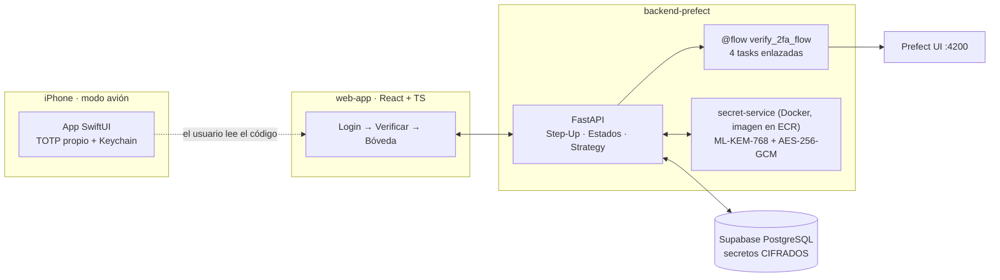

# Step-Up 2FA (TOTP) desde cero + Observabilidad con Prefect

Prueba de concepto de **autenticación escalonada (Step-Up)** con un segundo factor **TOTP implementado desde cero** (RFC 6238), observado paso a paso con **Prefect**, y con el secreto TOTP protegido en reposo con **criptografía post-cuántica** (ML-KEM-768).

| Componente | Tecnología | Carpeta |
| --- | --- | --- |
| App Authenticator (funciona en modo avión) | SwiftUI · CryptoKit · Keychain · VisionKit | [`mobile-authenticator/`](mobile-authenticator) |
| Backend de autenticación + flows observables | Python 3.12 · FastAPI · Prefect 3 · PostgreSQL | [`backend-prefect/`](backend-prefect) |
| Custodio de secretos post-cuántico (contenedor) | ML-KEM-768 + AES-256-GCM · Docker · Amazon ECR | [`backend-prefect/secret-service/`](backend-prefect/secret-service) |
| Sistema de login | React · TypeScript · Vite | [`web-app/`](web-app) |
| Base de datos (solo base de datos) | Supabase PostgreSQL | [`backend-prefect/sql/`](backend-prefect/sql) |

---

## Arquitectura



- La app móvil y el backend **nunca se comunican**: comparten el secreto (vía QR) y el reloj, y cada uno calcula `HMAC-SHA1(secreto, floor(t / 30))` por su lado.
- **Supabase es solo la base de datos.** El backend se conecta directo a PostgreSQL; la Data API de Supabase está apagada y no se usa Supabase Auth.
- La web **solo** habla con el backend.

## Flujo Step-Up

1. `POST /auth/login` (usuario + contraseña) devuelve un **`pre_auth_token`** de 5 minutos que **no** da acceso a recursos protegidos: su `scope` solo permite configurar o verificar el segundo factor.
2. `POST /auth/verify-2fa` (código + `pre_auth_token`) ejecuta el flow de Prefect:

| # | Task | Qué hace |
| --- | --- | --- |
| 1 | `validate_pre_auth_state` | Valida firma, expiración y `scope` del token temporal, y que el 2FA esté `ACTIVE`. |
| 2 | `check_anti_replay_cache` | Si `(user_id, código)` se usó en los últimos 90 s, lanza **`ReplayAttackDetected`**. |
| 3 | `execute_mfa_strategy` | `TOTPStrategy` (ventanas C-1, C, C+1; registra cuál hizo match) o `BackupCodeStrategy`. |
| 4 | `issue_elevated_session` | Marca el código como usado y emite el **`access_token`** con `mfa_verified: true`. |

3. `GET /api/boveda-secreta` solo responde a un `access_token` con `mfa_verified: true`.

Cada task recibe el resultado de la anterior: por eso Prefect UI dibuja el grafo con flechas, y un fallo se ve en rojo exactamente en la task que lo detectó.

## Patrones implementados

| Patrón | Dónde |
| --- | --- |
| **Step-Up Authentication** | Tokens con `scope` en [`app/security.py`](backend-prefect/app/security.py): `mfa:setup` → `mfa:verify` → `vault:read`. |
| **Process Manager / Máquina de estados** | `NONE → PENDING_VERIFICATION → ACTIVE` en [`app/flows.py`](backend-prefect/app/flows.py) (`provision_mfa_flow`, `confirm_mfa_flow`). El 2FA solo se activa tras el primer código válido. |
| **Strategy** | `SecondFactorStrategy` con `TOTPStrategy` y `BackupCodeStrategy` en [`app/strategies.py`](backend-prefect/app/strategies.py). |
| **Ports & Adapters** | `SecretVault` en [`app/vault.py`](backend-prefect/app/vault.py): adaptador remoto (contenedor) o local, intercambiables. |

## TOTP desde cero

Sin librerías que entreguen el código calculado. Solo se usan las primitivas permitidas (HMAC-SHA1 y Base32 estándar):

- **iOS:** [`TOTP/TOTP.swift`](mobile-authenticator/MobileAuthenticator/TOTP/TOTP.swift) (HMAC con CryptoKit, contador big-endian, truncamiento dinámico) y [`TOTP/Base32.swift`](mobile-authenticator/MobileAuthenticator/TOTP/Base32.swift) (decodificador propio).
- **Backend:** [`app/totp.py`](backend-prefect/app/totp.py), con `hmac` y `base64` de la librería estándar.
- Ambos pasan los **vectores de prueba del Apéndice B del RFC 6238** ([`tests/test_totp.py`](backend-prefect/tests/test_totp.py)).

---

## Cómo levantar el sistema

### Requisitos

- macOS con Xcode 16+ y un iPhone (iOS 17+), Node.js 20+, Docker Desktop.
- [`uv`](https://docs.astral.sh/uv/) (instala Python 3.12 automáticamente).
- Un proyecto de Supabase (solo como PostgreSQL).
- AWS CLI configurada con un usuario con permisos de ECR (solo para usar la imagen desde ECR).

### 1 · Base de datos

En Supabase → **SQL Editor**, ejecuta [`backend-prefect/sql/schema.sql`](backend-prefect/sql/schema.sql). Luego, en **Project Settings → Data API**, desactiva la Data API.

### 2 · Variables de entorno del backend

```bash
cd backend-prefect
cp .env.example .env
uv run python secret-service/generate_key.py   # genera la llave ML-KEM-768: cópiala a MLKEM_PRIVATE_KEY
openssl rand -hex 32                            # cópialo a JWT_SECRET
```

| Variable | Qué es |
| --- | --- |
| `DATABASE_URL` | Cadena del **Session pooler** de Supabase (Connect → Session pooler). |
| `JWT_SECRET` | Llave HMAC con la que el backend firma los JWT. |
| `MLKEM_PRIVATE_KEY` | Llave privada ML-KEM-768 (Base64). Si se pierde, los secretos guardados no se pueden descifrar. |
| `SECRET_SERVICE_URL` | `http://127.0.0.1:8001` para usar el contenedor. Vacía = cifrado en el mismo proceso (modo local). |
| `PREFECT_API_URL` | `http://127.0.0.1:4200/api` |

`.env` y `.env.*` están en `.gitignore`, y un hook de **gitleaks** bloquea commits con secretos.

### 3 · Prefect (terminal 1)

```bash
cd backend-prefect
uv run prefect server start
```

Prefect UI: http://127.0.0.1:4200

### 4 · secret-service (contenedor)

El contenedor recibe **solo** la llave ML-KEM:

```bash
grep '^MLKEM_PRIVATE_KEY=' backend-prefect/.env > backend-prefect/.env.secret-service
```

**Opción A · imagen desde Amazon ECR**

```bash
REGISTRY=$(aws sts get-caller-identity --query Account --output text).dkr.ecr.us-east-1.amazonaws.com
aws ecr get-login-password --region us-east-1 | docker login --username AWS --password-stdin $REGISTRY
docker run -d --name secret-service -p 127.0.0.1:8001:8001 \
  --env-file backend-prefect/.env.secret-service $REGISTRY/secret-service:v1.0.0
```

**Opción B · construir en local**

```bash
docker build -t secret-service:v1.0.0 backend-prefect/secret-service
docker run -d --name secret-service -p 127.0.0.1:8001:8001 \
  --env-file backend-prefect/.env.secret-service secret-service:v1.0.0
```

El puerto se publica solo en `127.0.0.1`: el servicio no tiene autenticación propia y nunca debe quedar expuesto en la red.

### 5 · Backend (terminal 2)

```bash
cd backend-prefect
uv run uvicorn app.main:app --reload --port 8000
```

- `GET /health` debe responder `"secret_vault": "secret-service (contenedor)"`.
- Documentación interactiva: http://127.0.0.1:8000/docs

### 6 · Web (terminal 3)

```bash
cd web-app
npm install
npm run dev
```

Abrir **http://localhost:5173**. Debe ser `localhost`: es el único origen permitido por CORS.

### 7 · App iOS

1. Abrir [`mobile-authenticator/MobileAuthenticator.xcodeproj`](mobile-authenticator/MobileAuthenticator.xcodeproj).
2. **Signing & Capabilities** → elegir tu equipo.
3. Destino: tu iPhone → **⌘R**.
4. La primera vez: en el iPhone, **Ajustes → General → VPN y gestión de dispositivos** → confiar en el desarrollador.

---

## Pruebas

```bash
cd backend-prefect
uv run pytest   # TOTP contra los vectores del RFC 6238 + cifrado post-cuántico (sin mocks)
```

## Pruebas de aceptación

| Prueba | Cómo se ve |
| --- | --- |
| **1 · Paridad** | El mismo QR en esta app y en Google/Microsoft Authenticator muestra los mismos 6 dígitos al mismo tiempo. |
| **2 · Modo avión** | Con el iPhone en modo avión, el código sigue cambiando y permite entrar a `GET /api/boveda-secreta`. |
| **3 · Anti-replay** | Reusar un código en menos de 90 s se rechaza y el flow queda **Failed** en `check_anti_replay_cache`. |
| **4 · Clock skew / respaldo** | Los logs de `execute_mfa_strategy` muestran la ventana del match (C-1, C o C+1). Un código de respaldo funciona una sola vez. |

---

## Decisiones de seguridad

- **Contraseñas y códigos de respaldo:** hasheados con **Argon2** (irreversibles).
- **Secreto TOTP:** el servidor necesita recuperarlo para calcular códigos, así que se **cifra** (no se hashea) con un esquema híbrido post-cuántico:
  - **ML-KEM-768** (FIPS 203) encapsula una llave de 32 bytes,
  - **HKDF-SHA256** deriva la llave de AES,
  - **AES-256-GCM** cifra y detecta alteraciones.

  La llave privada vive solo en el contenedor `secret-service`.
- **El HMAC-SHA1 del TOTP no se reemplaza** por un algoritmo post-cuántico: el estándar RFC 6238 lo exige para la compatibilidad con Google y Microsoft Authenticator.
- **iOS:** los secretos se guardan en el **Keychain** con `WhenUnlockedThisDeviceOnly`: no viajan a iCloud ni a otro dispositivo.
- **Prefect:** el token y el código se pasan como `SecretStr`, así que la UI los muestra como `**********`.
- **SQL:** todas las consultas son parametrizadas. Los roles públicos de Supabase no tienen permisos sobre las tablas, y RLS está activado.
- **Contenedor:** imagen multi-stage, usuario no-root, `HEALTHCHECK`, sin secretos en la imagen. En ECR: tags inmutables y escaneo de vulnerabilidades al subir.
- **CORS:** solo `http://localhost:5173`.

### Limitaciones conocidas (PoC)

- La caché anti-replay vive en memoria: se pierde si se reinicia el backend y no se comparte entre varias instancias. En producción iría en Redis.
- El `secret-service` no tiene autenticación propia: depende de estar expuesto solo en `127.0.0.1` o en una red privada.
- Los tokens de la web viven en `sessionStorage`. En producción serían cookies `HttpOnly`.
